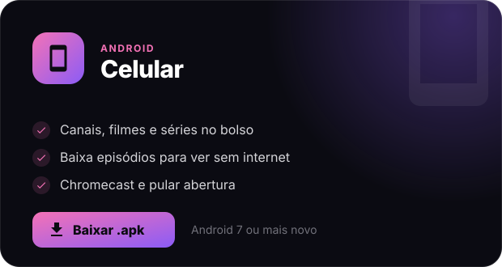
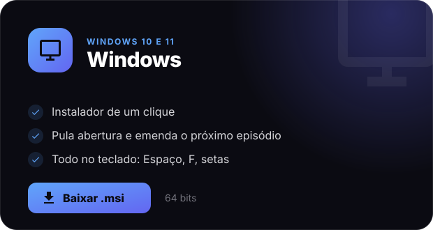
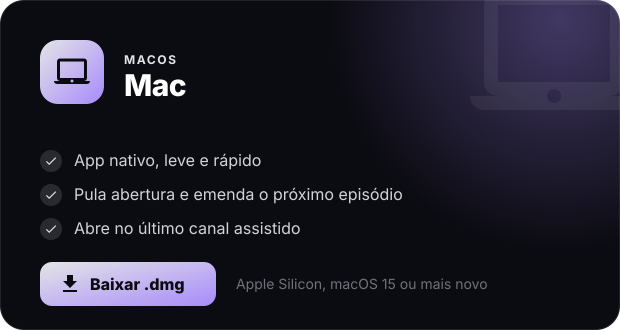
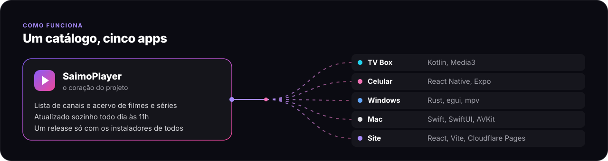

  

  
  
  

  
  
  
  

<table>
  <tr>
    <th align="left">Repositório</th>
    <th align="left">O que é</th>
    <th align="left">Feito com</th>
  </tr>
  <tr>
    <td><a href="https://github.com/gabrielsaimo/SaimoPlayer"><b>SaimoPlayer</b></a></td>
    <td>Catálogo de canais e acervo, releases e o app do Mac</td>
    <td>Swift, SwiftUI, Python</td>
  </tr>
  <tr>
    <td><a href="https://github.com/gabrielsaimo/SaimoTV-Android"><b>SaimoTV-Android</b></a></td>
    <td>App para TV Box e Google TV, todo no controle remoto</td>
    <td>Kotlin, Media3</td>
  </tr>
  <tr>
    <td><a href="https://github.com/gabrielsaimo/Saimo-Cell-V2"><b>Saimo-Cell-V2</b></a></td>
    <td>App para celular Android, com downloads e Chromecast</td>
    <td>React Native, Expo</td>
  </tr>
  <tr>
    <td><a href="https://github.com/gabrielsaimo/SaimoWin"><b>SaimoWin</b></a></td>
    <td>App para Windows, um executável com o mpv ao lado</td>
    <td>Rust, egui, mpv</td>
  </tr>
  <tr>
    <td><a href="https://github.com/gabrielsaimo/Saimo-TV"><b>Saimo-TV</b></a></td>
    <td>Site, instalável como app</td>
    <td>React, Vite, TypeScript</td>
  </tr>
</table>

 

## Olá! eu sou o Saimo

 
  
  
  
  
  
  
  
  
  
  
  
  
  
  
  
  
  
  
  
  
  
  
  
  
  
  
  
  
   
  
  
  
  

##

 
  
  
   
  

  
<picture>
  <source media="(prefers-color-scheme: dark)" srcset="https://raw.githubusercontent.com/gabrielsaimo/gabrielsaimo/output/github-contribution-grid-snake-dark.svg">
  
</picture>
